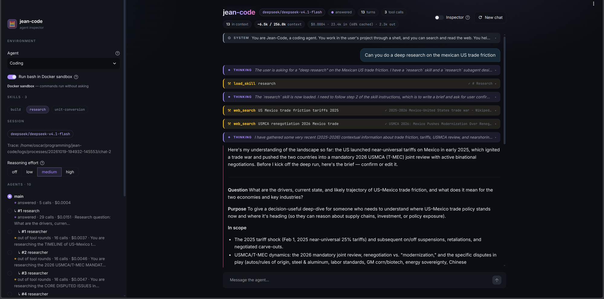

# Jean-Code - A minimal Coding Harness for Educational Purposes.

A small coding agent that works in your shell and in your browser. Built on [OpenRouter](https://openrouter.ai) (DeepSeek V4.1 Flash by default) - Supports all the goodies you're used to in agents: bash, tools, web-browsing, subagents, etc.



## Running it

You need [uv](https://docs.astral.sh/uv/). Docker is optional, but the sandbox and the `general` subagent need it
(see [Where commands run](#where-commands-run)).

**1. Add your OpenRouter key.** Create a key at <https://openrouter.ai/keys>, then put it in a `.env` file at the
repo root (it is gitignored):

```sh
echo 'OPENROUTER_API_KEY=sk-or-v1-...' > .env
```

The key needs credits on your OpenRouter account. With the default model, sessions are cheap: the one in the
screenshot above (11 model calls, 104k input tokens) cost $0.006.

**2. (Optional) Build the sandbox image.** Skip this if you don't have Docker.

```sh
docker build -t jean-code-sandbox sandbox/
# if your user id isn't 1000:
docker build --build-arg UID=$(id -u) --build-arg GID=$(id -g) -t jean-code-sandbox sandbox/
```

The sandbox mounts the repo's `workspace/` folder into the container (and nothing else). Docker Desktop can only
mount folders under your home directory by default, so if the repo is cloned elsewhere (e.g. `/tmp`), the sandbox
fails with "Mounts denied": clone it under your home, or add its location under Settings → Resources → File sharing.

**3. Start a front-end.** `uv run` installs the dependencies on first use.

```sh
# Streamlit UI, at http://localhost:8501
uv run --env-file .env streamlit run src/jean_code/ui/app.py

# Terminal REPL
uv run --env-file .env jean-code
```

jean-code runs from its repo checkout: it reads `skills/` and writes `workspace/` and `logs/` next to its code. To
put `jean-code` on your PATH, install it editable with `uv tool install -e ~/jean-code`; a copying install refuses to
start.

In the UI, the sidebar has the sandbox switch ("Run bash in Docker sandbox", which starts a new chat) and the
reasoning effort. Type `/compact` in the chat to summarize older turns now.

REPL options: `--sandbox` runs commands in Docker, `--no-network` cuts the container off from the network,
`--model` takes any OpenRouter model id, `--reasoning low|medium|high`, `--max-cost` stops the session at a USD
limit, and `--compact-at` sets the token count that triggers compaction. Type `/cost` to see what the session has
spent, and `exit` to quit.

### Where commands run

- **On your machine (the default):** commands run in the directory you started the front-end from, and each one
  waits for your approval. Started from the repo root, the agent works on jean-code itself. To point it at another
  project, start it from there:

  ```sh
  cd ~/my-project
  uv run --project ~/jean-code --env-file ~/jean-code/.env jean-code
  ```

- **In the sandbox (`--sandbox`, or the UI switch):** commands run in a container, in `/workspace`, which is the
  repo's `workspace/` folder. They don't ask for approval, and they can't see the rest of your machine.

The `general` subagent always runs in its own sandbox container, even when the main agent runs on your machine, so
without Docker and the image it fails, and only the `searcher` subagent works.

## Key features

- **Runs commands for you**, on your machine with your approval, or in a Docker sandbox without asking.
- **Searches the web** and reads pages when it needs documentation or answers.
- **Delegates to subagents**: a web researcher, and a coding agent that experiments in the sandbox while the main
  one keeps working.
- **Research reports**: ask it to research something and it agrees a brief with you, then a research run works in
  the background. Researchers record facts with quotes that are checked against the pages they fetched, and a lead
  writes a report citing them, to `workspace/research/<run>/report.md`.
- **Skills**: teach it a task with a folder in `skills/`: a `SKILL.md` (YAML front matter with a `name` and a
  `description`, then the instructions) plus any reference files. See `skills/unit-conversion/` for an example.
- **Long sessions**: when the conversation gets too long, it summarizes the older turns and carries on.
- **Cost control**: shows what each session costs, and stops at a spending limit you set. Every model call is also
  logged to `logs/usage.jsonl`.
- **See what it's doing**: the UI shows every thought, tool call and result live, for the main agent and each subagent.

## How a turn works

The whole agent is the `Agent` class in `src/jean_code/core/agent.py`. A turn is one call to `agent.run_turn(text)`:

1. The user's message is appended to `agent.messages`, the transcript in the OpenAI chat format.
2. The transcript and the tool schemas are sent to the model. Its reply is appended as the API returned it.
3. If the reply has tool calls, each one is run and its result appended, and the loop goes back to step 2.
   If it has none, the reply is the answer and the turn ends.

A tool call that needs the user's approval doesn't end the turn. The agent is built with an `approve` function,
which it calls with the tool's name and arguments and waits for: it returns None to run the call, or the text the
model gets as the result instead. The front-ends pass `Approvals.ask` (`ui/approval.py`), which hands the question
to their own thread.

A turn ends early when it's interrupted, when the budget is spent or cancelled, when the context is nearly full, or
when it runs out of tool rounds. Whatever notices raises `TurnStopped`, and `run_turn` catches it and returns
which: "answered", "interrupted", "budget spent", "cancelled", "context full" or "out of tool rounds".

The front-ends don't get events from the agent. They run the turn on a thread, read the agent's state as it
grows (`messages`, `usage` with one entry per model call, and `budget`), and keep what the call returned.

Everything else is built on that loop:

| Feature | How | Read |
|---|---|---|
| Tools | Typed, documented functions marked `@tool`; the schema comes from the signature and docstring | `core/llm.py`, `tools/web.py` |
| Shell | The `bash` and `job` tools, on the host or in a container | `tools/shell.py` |
| Skills | Listed in the system prompt; the model loads a skill's instructions when a task matches | `core/skills.py` |
| Subagents | The `spawn` tool starts another `Agent` on its own thread, with its own limit inside the parent's budget | `core/subagents.py` |
| Compaction | Between turns, the model summarizes the middle of a long conversation | `Agent.compact` |
| Budget | A tree of spending limits that mirrors the agents | `core/usage.py` |

## Layout

```
src/jean_code/
  config.py                paths in the repo
  core/                    the agent machinery; imports nothing from the packages below
    agent.py               the agent loop: tool calls, compaction
    llm.py                 OpenRouter client, and tool schemas built from functions
    usage.py               cost records, logging and budgets
    subagents.py           starting, waiting for and managing subagent runs
    skills.py              skills: discovery, the load tools and /name commands
    compaction_prompts.py  the compaction prompt and the messages it writes
  tools/                   what a model calls; imports only core
    shell.py               host and Docker shell backends
    web.py                 the web tools agents call: search, and fetching a page a window at a time
    pages.py               page text from HTML and PDFs, cached per URL, and the windows cut from it
  agents/                  agents assembled from core and tools
    coding.py              the coding agent and its subagent profiles
    research.py            research runs: a lead, researchers and the notebook of checked facts they share
    prompts.py             the agents' system prompts
  ui/                      the front-ends
    repl.py                terminal front-end
    app.py                 Streamlit front-end (app.css holds its styles)
    approval.py            asking the user before a tool call runs
skills/                    skill folders
sandbox/                   Dockerfile for the sandbox
tests/                     unit tests (test_layout.py checks the layers), with a scripted fake model: no API key needed
docs/                      the README's screenshot

Created at runtime (gitignored):
workspace/                 the sandbox's /workspace; research runs in workspace/research/
logs/                      usage.jsonl, one line per model call
```

Run the tests with `uv run pytest`, the linter with `uv run ruff check` and the type checker with
`uv run pyright`. All three should pass.
